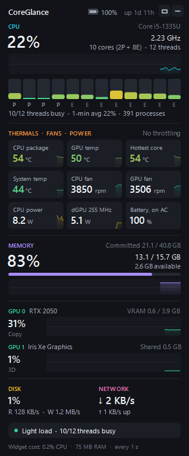
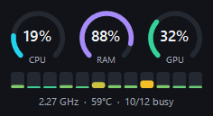

# CoreGlance

A small always-on desktop widget for Windows 10/11 that shows what your laptop is doing right now:
CPU load per thread (P-cores and E-cores labelled), clock speed, memory, both GPUs, temperatures,
fan speeds, CPU/GPU power draw, battery charge rate, disk, network, the busiest processes and a
one-line "what's the bottleneck" insight.

<p>
  
  &nbsp;&nbsp;
  
</p>

*Standard view (left, admin sensor mode with PawnIO on an Acer Aspire 5) and compact view (right).*

- **Small:** one ~140 KB exe, no installer framework, no runtime to download (it uses the .NET Framework 4.8 built into Windows).
- **Light:** about 0.1–0.3% CPU and ~10–20 MB of RAM at a 1 s refresh. The cost is shown at the bottom of the widget.
- **Accurate:** CPU, GPU, disk and network numbers come from Windows performance counters, the same source Task Manager uses.

## Install

```powershell
powershell -ExecutionPolicy Bypass -File .\install.ps1
```

This copies the exe to `%LOCALAPPDATA%\Programs\CoreGlance`, adds a Start Menu shortcut, starts it with
Windows and launches it. Use `-NoAutostart` to skip autostart, or `-EnableSensors` to turn on fan readings
in the same step (one UAC prompt).

Rebuild from source at any time with `.\build.ps1` (output: `dist\CoreGlance.exe`).
Remove everything with `.\uninstall.ps1` (add `-KeepSettings` to keep your layout).

## Using it

| Action | How |
| --- | --- |
| Move | Drag anywhere. It snaps to screen edges and remembers its position |
| Minimize to tray | The **–** button (top right), or Ctrl+Alt+Shift+M from anywhere |
| Bring back | Click the tray icon (it shows CPU and RAM bars), or Ctrl+Alt+Shift+M |
| Compact or full view | The **▢** button, or double-click to cycle Compact, Standard, Detailed |
| Thread detail | Hover a core bar: `CPU 5 · E-core 1 · 34% busy` |
| Top processes | Detailed view; click **CPU** or **MEM** to sort |
| Options | Right-click: always on top, lock position, click-through, opacity, refresh rate, hide over full-screen apps, start with Windows |

It hides itself while a full-screen app or video is playing and comes back afterwards
(turn this off under right-click > *Hide over full-screen apps*). Sampling pauses while the PC is locked.

## Temperatures, fans and power

CoreGlance works on any Windows 10/11 laptop. It reads each sensor from the best source the machine
has, and a tile only appears when a reading exists.

**Every laptop, no setup:**

| Reading | Source |
| --- | --- |
| Thermal zone temperature, throttling | Windows thermal-zone counters |
| CPU package power (W) | Intel/AMD RAPL energy counters |
| NVIDIA GPU temperature, power, clock | `nvml.dll` from the NVIDIA driver |
| Battery charge/discharge rate, time left | Windows battery WMI |

**Laptop-maker firmware** (fan RPM plus CPU/GPU temperatures; most need admin sensor mode):

| Brand | Interface | Based on |
| --- | --- | --- |
| Acer (Nitro, Predator, Aspire) | `AcerGamingFunction` WMI | Linux `acer-wmi` (tested on Aspire A515-58GM) |
| ASUS (ROG, TUF, Zenbook, Vivobook) | `\\.\ATKACPI` driver | G-Helper |
| Lenovo (Legion, LOQ, IdeaPad Gaming) | `LENOVO_OTHER_METHOD` / `LENOVO_FAN_METHOD` WMI | Lenovo Legion Toolkit |
| HP (Omen, Victus) | `hpqBIntM` BIOS WMI | OmenMon |
| Dell (Alienware, G-series) | `AWCCWmiMethodFunction` WMI | alienfx-tools |

**Advanced CPU sensors** (optional, right-click > *Advanced CPU sensors*): this installs
[PawnIO](https://pawnio.eu), the small signed open-source driver LibreHardwareMonitor uses, from winget. It adds:
- exact CPU package temperature and hottest-core temperature on **any Intel** laptop (MSR);
- CPU Tctl on **any AMD Ryzen** laptop (SMN);
- fan RPM and CPU/GPU temperatures on **ordinary Dell** laptops (Inspiron, Latitude, Vostro, XPS) through Dell SMM.

The official signed PawnIO modules (`IntelMSR`, `AMDFamily17`, `DellSMM`, LGPL-2.1, see
`assets/pawnio/COPYING-LGPL-2.1.txt`) are embedded in the exe, so nothing else is downloaded.

**Admin sensor mode:** firmware interfaces and the PawnIO driver only answer admin programs. Right-click >
**Enable temperatures & fans (admin)...** asks for UAC once, copies the exe to `C:\Program Files\CoreGlance`
(where a normal-user program can't replace it) and registers a scheduled task named `CoreGlance`. From then
on, the normal launcher starts the admin copy through that task, with no UAC prompt each time.
CoreGlance only *reads* sensors and never changes fan or power settings. *About CoreGlance* lists the
sensor sources in use on your machine.

NVIDIA readings appear only while the dGPU is already awake. CoreGlance never wakes a sleeping
Optimus GPU, because that would drain the battery.

**Limits:** laptops outside these brands (for example most Samsung, MSI and ThinkPad models) have no
standard fan-speed interface, so they show temperatures but no fan RPM. Only the Acer path is verified on
real hardware; the other brands follow the open-source tools named above.

## Files

- `src/`: C# source (`SysMonitor` counters, `Sensors` firmware/WMI/NVML thread, `WidgetForm` UI)
- `%APPDATA%\CoreGlance\settings.ini`: your settings; `error.log`: errors, if any
- `CoreGlance.exe --snapshot out.png`: renders the widget off-screen to a PNG (diagnostics)
