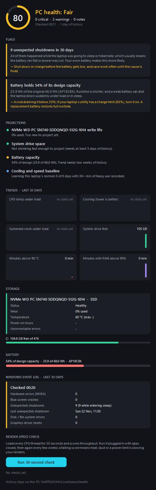

# CoreGlance

A small always-on desktop widget for Windows 10/11 that shows what your laptop is doing right now:
CPU load per thread (P-cores and E-cores labelled), clock speed, memory, both GPUs, temperatures,
fan speeds, CPU/GPU power draw, battery charge rate, disk, network, the busiest processes and a
one-line "what's the bottleneck" insight.

<p>
  
  &nbsp;&nbsp;
  
</p>

*Standard view (left, admin sensor mode with PawnIO on an Acer Aspire 5) and compact view (right).*

- **Small:** one ~190 KB exe, no installer framework, no runtime to download (it uses the .NET Framework 4.8 built into Windows).
- **Light:** about 0.1–0.3% CPU and ~10–20 MB of RAM at a 1 s refresh. The cost is shown at the bottom of the widget.
- **Accurate:** CPU, GPU, disk and network numbers come from Windows performance counters, the same source Task Manager uses.

## Install

```powershell
powershell -ExecutionPolicy Bypass -File .\install.ps1
```

This copies the exe to `%LOCALAPPDATA%\Programs\CoreGlance`, adds a Start Menu shortcut, starts it with
Windows and launches it. Use `-NoAutostart` to skip autostart, or `-EnableSensors` to turn on fan readings
in the same step (one UAC prompt).

Rebuild from source at any time with `.\build.ps1` (output: `dist\CoreGlance.exe`).
Remove everything with `.\uninstall.ps1` (add `-KeepSettings` to keep your layout).

## Using it

| Action | How |
| --- | --- |
| Move | Drag anywhere. It snaps to screen edges and remembers its position |
| Open | Start Menu > CoreGlance, or its pinned icon. Opening it always shows the widget, even if it was hidden |
| Pin to the taskbar | Right-click its taskbar icon > *Pin to taskbar* (right-click the widget > *Show in taskbar* turns the taskbar button off) |
| Minimize | The **–** button (top right), the taskbar icon, or Ctrl+Alt+Shift+M from anywhere |
| Hide to tray | Right-click > *Hide to tray*; click the tray icon (it shows CPU and RAM bars) to bring it back |
| Compact or full view | The **▢** button, or double-click to cycle Compact, Standard, Detailed |
| Thread detail | Hover a core bar: `CPU 5 · E-core 1 · 34% busy` |
| GPU apps | The line under each GPU names the apps using it, or who holds its memory when idle (Standard and Detailed) |
| Top processes | Detailed view; click **GPU**, **CPU** or **MEM**. GPU rows show which GPU, the app's busiest engine and its GPU memory |
| PC health report | Click the **Health** badge next to the title (the dot in compact view), or right-click > *PC health report* |
| Options | Right-click: always on top, lock position, click-through, opacity, refresh rate, hide over full-screen apps, start with Windows |

It hides itself while a full-screen app or video is playing and comes back afterwards
(turn this off under right-click > *Hide over full-screen apps*). Sampling pauses while the PC is locked.

## Low power mode

The **Power mode** row at the top of the widget has three buttons, **Off | Saver | Max**, each showing how
long the battery would last in that mode at what you are doing right now. Clicking the battery in the header
cycles through the same three modes (right-click > *Low power mode* has them too).

Battery time comes from the battery's real drain while you are unplugged. When plugged in, it estimates the
drain from the CPU's measured power plus the rest of the laptop. CoreGlance learns that "rest" (screen,
SSD, Wi-Fi) each time you run on battery; until then it assumes 4.5 W. It leaves 5% in reserve, where
Windows shuts down. The other modes are scaled by the savings measured below.

Low power mode makes the battery last longer. CoreGlance switches to a copy of your own power plan with the CPU tuned for efficiency, and switches
back when you turn it off. The copy is then deleted, and nothing else on your plan changes.

| Level | What it does |
| --- | --- |
| **Battery saver** | CPU capped at 2.0 GHz (E-cores 1.6 GHz), Windows' efficiency preference raised to 80, Windows Energy Saver always on while on battery |
| **Max saver** | Capped at 1.6 GHz (E-cores 1.3 GHz), efficiency preference 90, and work goes to the efficient E-cores first |

*Turn on automatically on battery* switches it on when you unplug and off when you plug back in.
While it is on, the widget refreshes every 2 seconds at most, so it uses less power itself.

Measured on the i5-1335U at full load, CPU package power (RAPL):

| Plan | CPU power | Speed | Work per watt |
| --- | --- | --- | --- |
| Acer default | 31-35 W | 100% | 71-87 |
| Battery saver | 8.2 W | 36% | 116 |
| Max saver settings | 7.0 W | 25% | 95 |

At light use the CPU drew 6-9 W instead of 10-22 W. Heavy work (renders, exports, games) runs much slower
in low power mode, so turn it off for those. Not used: core parking, which made the laptop about 6× slower
again for little extra saving.

## PC health: flags before hardware fails

CoreGlance keeps a small daily history and turns it into a health score (0-100), **flags** with a
plain-language fix, and **projections**. A tray notification appears when a new warning shows up
(critical: at most once a day; warnings: once a week). Click it to open the report.



| What it watches | Flags when | Projection |
| --- | --- | --- |
| CPU heat | 95 °C right now; over 10 min above 90 °C in a day; 5+ min of thermal throttling | - |
| Cooling efficiency (°C per watt under load) | 15% worse than this laptop's own baseline: dust or dried thermal paste | Learns your normal over 8 heavy-use days |
| Sustained clock under load ("render speed") | 15% slower than baseline | Shows today's vs normal GHz |
| Fans | A fan reads 0 rpm while the CPU is above 80 °C | - |
| GPU | 87 °C or more | - |
| SSD (SMART counters, admin mode) | Drive reports Warning/Unhealthy, uncorrectable errors, 70%+ wear, 70 °C+ | Years of write life left at your usage |
| Disk space | Under 10% free, or full within 30 days at the current rate | Days until the system drive is full |
| Battery (`powercfg` battery report) | Below 80% / 60% of design capacity | Capacity trend; runtime at today's drain |
| Memory | RAM over 90% for 15+ min in a day; commit charge at 95% | - |
| Windows event log (30 days) | WHEA hardware errors, blue screens, disk/file-system errors, GPU driver resets, repeated unexpected shutdowns (and whether they happened entering sleep) | - |
| Uptime | No restart for 14+ days | - |
| Render-speed check | A 30-second all-core test scores below 80% of your usual (median) score | Score history |

The **render-speed check** loads every CPU thread for 30 seconds. Run it plugged in, with the laptop
cool, then again every few weeks; a falling score catches heat, dust or power-limit slowdowns before
they become problems.

History is stored only on this PC in `%APPDATA%\CoreGlance\health` (`daily.csv`, `benchmarks.csv`).
Trend-based flags need a few days of use before they can fire.

## Temperatures, fans and power

CoreGlance works on any Windows 10/11 laptop. It reads each sensor from the best source the machine
has, and a tile only appears when a reading exists.

**Every laptop, no setup:**

| Reading | Source |
| --- | --- |
| Thermal zone temperature, throttling | Windows thermal-zone counters |
| CPU package power (W) | Intel/AMD RAPL energy counters |
| NVIDIA GPU temperature, power, clock | `nvml.dll` from the NVIDIA driver |
| Battery charge/discharge rate, time left | Windows battery WMI |

**Laptop-maker firmware** (fan RPM plus CPU/GPU temperatures; most need admin sensor mode):

| Brand | Interface | Based on |
| --- | --- | --- |
| Acer (Nitro, Predator, Aspire) | `AcerGamingFunction` WMI | Linux `acer-wmi` (tested on Aspire A515-58GM) |
| ASUS (ROG, TUF, Zenbook, Vivobook) | `\\.\ATKACPI` driver | G-Helper |
| Lenovo (Legion, LOQ, IdeaPad Gaming) | `LENOVO_OTHER_METHOD` / `LENOVO_FAN_METHOD` WMI | Lenovo Legion Toolkit |
| HP (Omen, Victus) | `hpqBIntM` BIOS WMI | OmenMon |
| Dell (Alienware, G-series) | `AWCCWmiMethodFunction` WMI | alienfx-tools |

**Advanced CPU sensors** (optional, right-click > *Advanced CPU sensors*): this installs
[PawnIO](https://pawnio.eu), the small signed open-source driver LibreHardwareMonitor uses, from winget. It adds:
- exact CPU package temperature and hottest-core temperature on **any Intel** laptop (MSR);
- CPU Tctl on **any AMD Ryzen** laptop (SMN);
- fan RPM and CPU/GPU temperatures on **ordinary Dell** laptops (Inspiron, Latitude, Vostro, XPS) through Dell SMM.

The official signed PawnIO modules (`IntelMSR`, `AMDFamily17`, `DellSMM`, LGPL-2.1, see
`assets/pawnio/COPYING-LGPL-2.1.txt`) are embedded in the exe, so nothing else is downloaded.

**Admin sensor mode:** firmware interfaces and the PawnIO driver only answer admin programs. Right-click >
**Enable temperatures & fans (admin)...** asks for UAC once, copies the exe to `C:\Program Files\CoreGlance`
(where a normal-user program can't replace it) and registers a scheduled task named `CoreGlance`. From then
on, the normal launcher starts the admin copy through that task, with no UAC prompt each time.
CoreGlance only *reads* sensors and never changes fan or power settings. *About CoreGlance* lists the
sensor sources in use on your machine.

NVIDIA readings appear only while the dGPU is already awake. CoreGlance never wakes a sleeping
Optimus GPU, because that would drain the battery.

**Limits:** laptops outside these brands (for example most Samsung, MSI and ThinkPad models) have no
standard fan-speed interface, so they show temperatures but no fan RPM. Only the Acer path is verified on
real hardware; the other brands follow the open-source tools named above.

## Files

- `src/`: C# source (`SysMonitor` counters, `Sensors` firmware/WMI/NVML thread, `WidgetForm` UI)
- `%APPDATA%\CoreGlance\settings.ini`: your settings; `error.log`: errors, if any
- `src/Shell.cs` (opening the running copy, taskbar identity, Start Menu shortcut)
- `src/Health.cs` (history, probes, flags, projections, render-speed check) and `src/HealthWindow.cs` (report)
- `CoreGlance.exe --snapshot out.png`: renders the widget off-screen to a PNG (diagnostics)
- `CoreGlance.exe --health-snapshot out.png`: renders the health report to a PNG
- `CoreGlance.exe --bench-test out.txt`: runs a short render-speed check and writes the score
